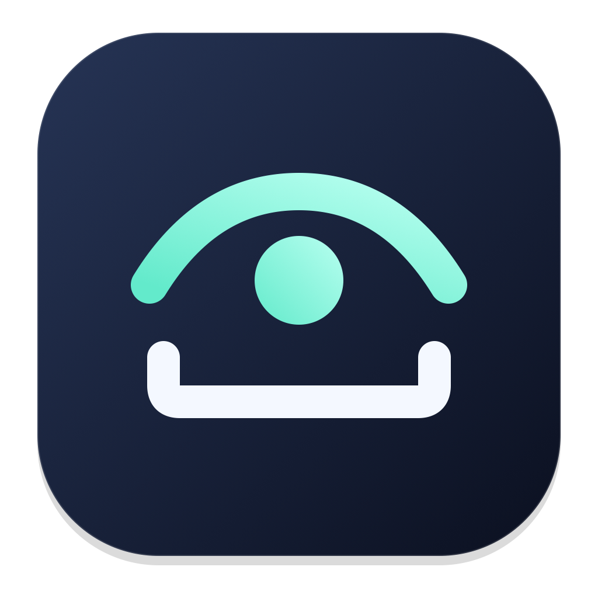

  

<h1 align="center">SpaceLook</h1>

<strong>More to see. Just press Space.</strong>

Preview Markdown, JSON, YAML, ZIP archives, and folders right in Finder.

SpaceLook brings more of your everyday files to the preview shortcut you already know. Read a document, check a configuration file, or see what’s inside an archive—all without leaving Finder.

## A closer look, one keystroke away

### Read Markdown as it was meant to look

Preview headings, tables, checklists, code blocks, and images in a clean reading view. Switch to the original source with a click whenever you want to see the details.

### Make sense of JSON and YAML

Syntax highlighting makes structured files easier to scan. Select and copy the text you need directly from the preview.

### Look inside ZIP files

See file names, paths, and original and compressed sizes without extracting the archive. Check what’s inside before unpacking it.

### Peek into folders

See a folder’s immediate contents in a clear list, with file types, sizes, and modification dates.

## Fits the way you use your Mac

- **Stay in Finder.** Select an item and press Space. Press Space again or Escape to close.
- **Make room for your content.** Resize and move the SpaceLook preview window. While the app is running, it remembers separate window layouts for documents and file lists.
- **Keep your Dock clear.** SpaceLook lives in the menu bar, with a single option to quit.
- **Keep familiar previews.** Photos, videos, music, and other formats continue to use the system preview.

## Start looking

With SpaceLook installed, launch it and select a supported item in Finder. Press **Space** to preview it.

For SpaceLook’s own preview window, macOS will ask for Accessibility access to handle the shortcut and permission to read your Finder selection. You can manage these permissions in System Settings.

Requires **macOS 13 or later**.

SpaceLook is currently available as source code. See the [build guide](CONTRIBUTING.md) to run it on your Mac.

## Good to know

**Does previewing still work after I quit?**  
SpaceLook also includes a Quick Look extension that macOS can load independently. Quitting the menu bar app does not disable that extension, so supported files may still preview. In that mode, macOS controls the window; SpaceLook’s saved window layouts apply only while the app is running. Other installed preview extensions can affect which preview appears.

**How large can my files be?**  
Markdown, JSON, and YAML previews support UTF-8 files up to 2 MB. Archive and folder lists show up to 100,000 entries, with an additional limit on stored names and paths. If a list reaches a limit, the preview tells you it has been shortened.

**Does a folder preview include everything inside it?**  
It shows the immediate, visible contents. Hidden items and nested folder contents are omitted, and folder sizes are not calculated recursively.

## Open source

SpaceLook is available under the [MIT License](LICENSE). Ideas, bug reports, and contributions are welcome on [GitHub](https://github.com/crapthings/SpaceLook).
